# Enterprise POS — ব্যবহার নির্দেশিকা (সহজ বাংলায়)

এই নির্দেশিকা দোকানের মালিক, ম্যানেজার, ক্যাশিয়ার ও স্টাফদের জন্য। এখানে ধাপে ধাপে দেখানো হয়েছে কীভাবে দোকানে বিক্রি করবেন, মালামাল (স্টক) সামলাবেন, অনলাইন অর্ডার দেখবেন আর হিসাব-রিপোর্ট দেখবেন।

> **সফটওয়্যারের বোতাম ও মেনু ইংরেজিতে।** তাই এই নির্দেশিকায় বোতামের নাম ইংরেজিতেই "উদ্ধৃতি চিহ্নের" ভেতরে লেখা আছে, যেমন "Sign in"। স্ক্রিনে ঠিক ওই লেখাটাই খুঁজবেন।
>
> ছবিগুলো ডেমো দোকান **Demo Mart** থেকে নেওয়া। আপনার দোকানে নাম, পণ্য আর সংখ্যা আলাদা হবে।

---

## সূচিপত্র

1. [শুরু করার আগে](#১-শুরু-করার-আগে)
2. [লগইন করা](#২-লগইন-করা)
3. [স্ক্রিনটা চিনে নিন](#৩-স্ক্রিনটা-চিনে-নিন)
4. [ড্যাশবোর্ড — এক নজরে ব্যবসা](#৪-ড্যাশবোর্ড--এক-নজরে-ব্যবসা)
5. [POS টার্মিনাল — দোকানে বিক্রি](#৫-pos-টার্মিনাল--দোকানে-বিক্রি)
6. [ক্যাশ রেজিস্টার — দিনের ক্যাশ হিসাব](#৬-ক্যাশ-রেজিস্টার--দিনের-ক্যাশ-হিসাব)
7. [বিক্রির তালিকা ও পণ্য ফেরত](#৭-বিক্রির-তালিকা-ও-পণ্য-ফেরত)
8. [পণ্য ও ক্যাটালগ](#৮-পণ্য-ও-ক্যাটালগ)
9. [স্টক / ইনভেন্টরি](#৯-স্টক--ইনভেন্টরি)
10. [কেনাকাটা — সাপ্লায়ারের কাছ থেকে মাল আনা](#১০-কেনাকাটা--সাপ্লায়ারের-কাছ-থেকে-মাল-আনা)
11. [গ্রাহক, সাপ্লায়ার ও লয়্যালটি পয়েন্ট](#১১-গ্রাহক-সাপ্লায়ার-ও-লয়্যালটি-পয়েন্ট)
12. [খরচ (Expenses)](#১২-খরচ-expenses)
13. [অনলাইন অর্ডার, ডেলিভারি ও COD](#১৩-অনলাইন-অর্ডার-ডেলিভারি-ও-cod)
14. [অফার ও কুপন (Promotions)](#১৪-অফার-ও-কুপন-promotions)
15. [রিপোর্ট ও Excel/PDF ডাউনলোড](#১৫-রিপোর্ট-ও-excelpdf-ডাউনলোড)
16. [AI Insights — কৃত্রিম বুদ্ধিমত্তার সাহায্য](#১৬-ai-insights--কৃত্রিম-বুদ্ধিমত্তার-সাহায্য)
17. [অনলাইন দোকান সাজানো](#১৭-অনলাইন-দোকান-সাজানো)
18. [ইউজার, রোল ও প্রতিষ্ঠানের সেটিংস](#১৮-ইউজার-রোল-ও-প্রতিষ্ঠানের-সেটিংস)
19. [ক্রেতার চোখে অনলাইন দোকান](#১৯-ক্রেতার-চোখে-অনলাইন-দোকান)
20. [দৈনিক কাজের তালিকা](#২০-দৈনিক-কাজের-তালিকা)
21. [সাধারণ সমস্যা ও সমাধান](#২১-সাধারণ-সমস্যা-ও-সমাধান)

---

## ১. শুরু করার আগে

**দুইটা আলাদা অংশ আছে:**

| অংশ | কারা ব্যবহার করবে | ঠিকানা (উদাহরণ) |
|---|---|---|
| **অ্যাডমিন / POS** | মালিক, ম্যানেজার, ক্যাশিয়ার, স্টাফ | `আপনার-ঠিকানা/admin` |
| **অনলাইন দোকান** | ক্রেতা (কাস্টমার) | `আপনার-ঠিকানা/` |

**কী লাগবে:** কম্পিউটার বা ট্যাবলেট, Chrome / Edge ব্রাউজার, ইন্টারনেট। বারকোড স্ক্যানার থাকলে বিক্রি অনেক দ্রুত হয় (না থাকলেও চলবে)।

**কে কী করতে পারবে (রোল):**

| রোল | সাধারণত কী করতে পারে |
|---|---|
| Organization Admin (মালিক) | সব কিছু |
| Branch Manager | নিজের ব্রাঞ্চের বিক্রি, স্টক, কেনাকাটা, রিপোর্ট, অনুমোদন |
| Accountant | পেমেন্ট, খরচ, রিপোর্ট |
| Inventory Manager | স্টক, ট্রান্সফার, কেনাকাটা |
| Cashier | শুধু POS-এ বিক্রি, ক্যাশ রেজিস্টার, ফেরতের অনুরোধ |

> যে কাজের অনুমতি আপনার নেই, সেই মেনু আপনি বাম পাশে দেখতেই পাবেন না। কিছু খুঁজে না পেলে মালিক/ম্যানেজারকে জিজ্ঞেস করুন।

---

## ২. লগইন করা

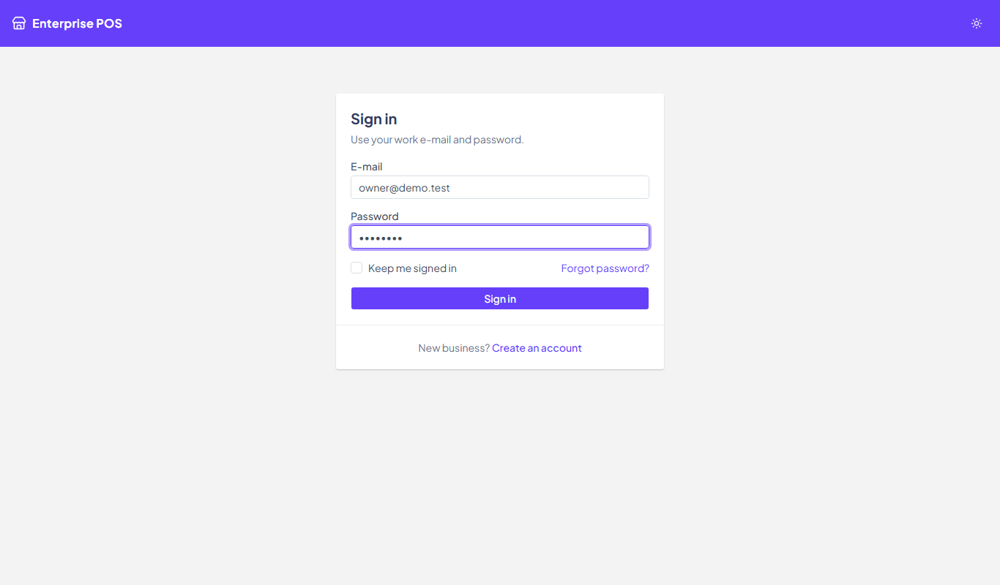

1. ব্রাউজারে `আপনার-ঠিকানা/admin` খুলুন।
2. **E-mail** ঘরে আপনার ই-মেইল লিখুন।
3. **Password** ঘরে পাসওয়ার্ড লিখুন।
4. **"Sign in"** চাপুন।

পাসওয়ার্ড ভুলে গেলে লগইন পাতার "Forgot password" লিংক থেকে ই-মেইলে রিসেট লিংক নিন।

> **নিরাপত্তা:** নিজের পাসওয়ার্ড কাউকে দেবেন না। কাজ শেষে, বিশেষ করে শেয়ার করা কম্পিউটারে, উপরে ডান কোণের গোল নামের চিহ্নে চাপ দিয়ে Sign out করুন।

---

## ৩. স্ক্রিনটা চিনে নিন

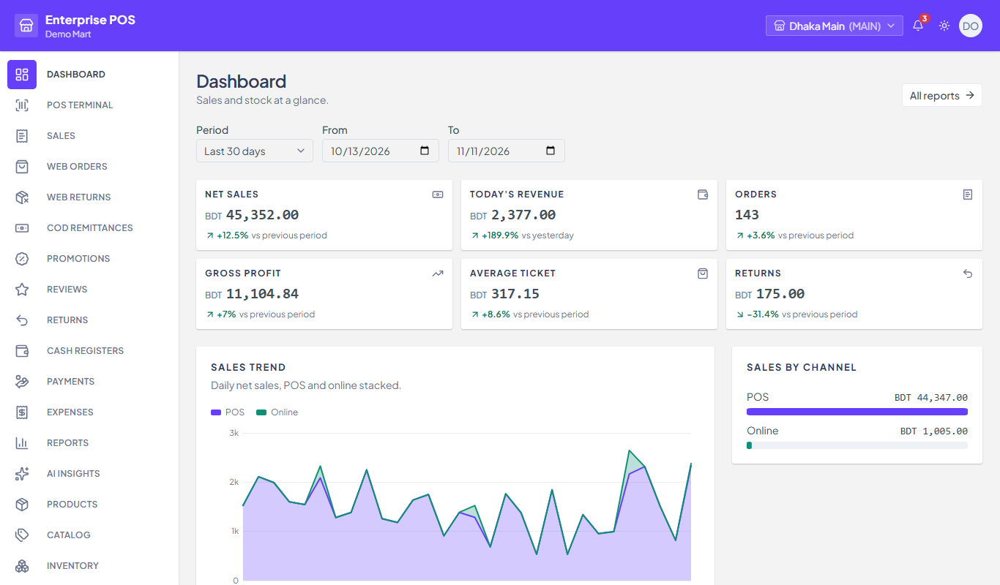

- **বাম পাশের মেনু:** সব কাজের তালিকা (Dashboard, POS Terminal, Sales, Products, Inventory …)।
- **উপরে ডানে ব্রাঞ্চ বাছাই** (ছবিতে "Dhaka Main (MAIN)"): একাধিক শাখা থাকলে এখান থেকে শাখা বদলান। সব তালিকা ও হিসাব বাছাই করা শাখার হয়।
- **ঘণ্টার চিহ্ন 🔔:** নোটিফিকেশন, যেমন স্টক কম, নতুন অনলাইন অর্ডার, অনুমোদনের অপেক্ষা।
- **সূর্য/চাঁদের চিহ্ন:** লাইট/ডার্ক মোড।
- **নামের গোল চিহ্ন:** প্রোফাইল, পাসওয়ার্ড বদল, Sign out।

**প্রায় সব তালিকায় যা পাবেন:**

- **সার্চ ঘর:** নাম, SKU বা বারকোড লিখে খুঁজুন।
- **ফিল্টার:** ক্যাটাগরি, স্টোর, তারিখ ইত্যাদি।
- **"Export":** তালিকাটা Excel বা PDF হিসেবে ডাউনলোড (১৫ নম্বর অংশ দেখুন)।
- নিচে পাতা বদলানোর বোতাম (Page 1 of 3 …)।

---

## ৪. ড্যাশবোর্ড — এক নজরে ব্যবসা

লগইন করলেই ড্যাশবোর্ড খোলে (উপরের ছবি)।

| কার্ড | মানে |
|---|---|
| **NET SALES** | ছাড় ও ফেরত বাদ দিয়ে আসল বিক্রি |
| **TODAY'S REVENUE** | আজকের আয় |
| **ORDERS** | কয়টা বিক্রি/অর্ডার হয়েছে |
| **GROSS PROFIT** | মোট লাভ (বিক্রি − মালের কেনা দাম) |
| **AVERAGE TICKET** | প্রতি বিক্রিতে গড়ে কত টাকা |
| **RETURNS** | কত টাকার মাল ফেরত এসেছে |

- সবুজ ↗ মানে আগের সময়ের চেয়ে বেড়েছে, লাল ↘ মানে কমেছে।
- **Period** থেকে সময় বাছুন (আজ, গত ৭ দিন, গত ৩০ দিন, এই মাস …) অথবা **From / To** তারিখ দিন।
- **SALES TREND** গ্রাফে প্রতিদিনের বিক্রি দেখায়: বেগুনি = দোকানে (POS), সবুজ = অনলাইন।
- **SALES BY CHANNEL** দেখায় দোকান আর অনলাইনে কত বিক্রি হলো।
- বিস্তারিত দেখতে উপরে ডানে **"All reports"** চাপুন।

---

## ৫. POS টার্মিনাল — দোকানে বিক্রি

বাম মেনু থেকে **"POS TERMINAL"** খুলুন।

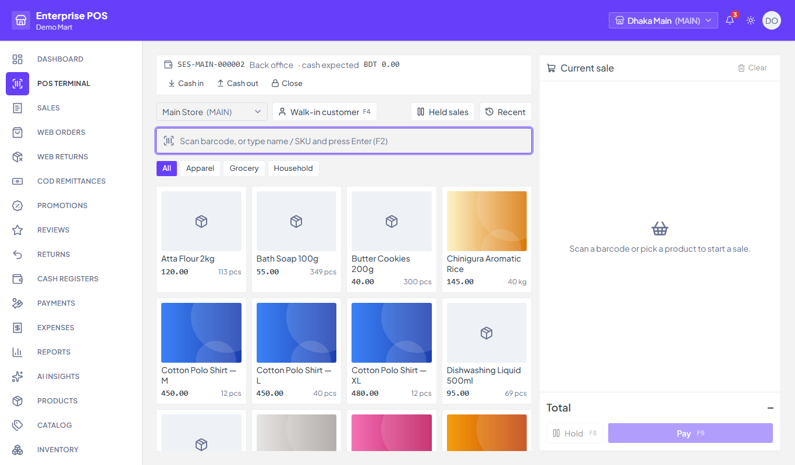

### ৫.১ প্রথমে ক্যাশ সেশন খুলুন

বিক্রি শুরুর আগে ক্যাশ ড্রয়ারের সেশন খোলা থাকতে হয়। উপরের বক্সে সেশন নম্বর (যেমন `SES-MAIN-000002`) আর ড্রয়ারে কত টাকা থাকার কথা ("cash expected") দেখায়। সেশন খোলা না থাকলে সফটওয়্যার নিজেই খুলতে বলবে: ড্রয়ারে শুরুতে কত টাকা আছে সেটা লিখে খুলুন। বিস্তারিত ৬ নম্বর অংশে।

### ৫.২ বিক্রি করার ধাপ

1. **স্টোর** ঠিক আছে কিনা দেখুন (ছবিতে "Main Store (MAIN)")।
2. **পণ্য যোগ করুন**, তিনভাবে করা যায়:
   - বারকোড স্ক্যান করুন, অথবা
   - সার্চ ঘরে (**F2**) নাম / SKU লিখে **Enter** চাপুন, অথবা
   - নিচের পণ্যের ছবিতে চাপুন। উপরের ট্যাব (All, Apparel, Grocery …) দিয়ে ক্যাটাগরি বাছতে পারেন।
3. ডান পাশে **"Current sale"**-এ পণ্যগুলো জমা হবে। **+ / −** দিয়ে পরিমাণ বদলান, আর ডাস্টবিন চিহ্ন দিয়ে পণ্য বাদ দিন। দরকার হলে লাইনের ছাড় চিহ্ন থেকে ছাড়ও দেওয়া যায় (অনুমতি থাকলে)।
4. পরিচিত ক্রেতা হলে **"Walk-in customer" (F4)** চেপে তাকে বেছে নিন বা নতুন যোগ করুন। এতে বাকির হিসাব আর লয়্যালটি পয়েন্ট ঠিক থাকবে।
5. **"Pay" (F9)** চাপুন।

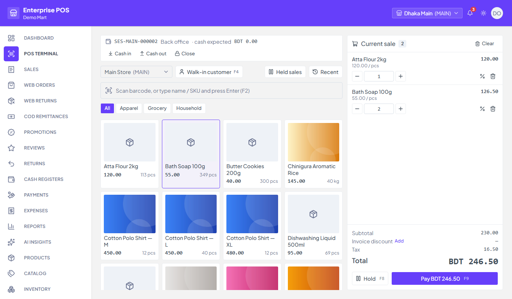

### ৫.৩ টাকা নেওয়া

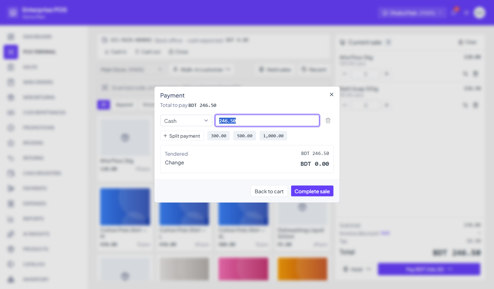

1. পেমেন্টের ধরন বাছুন: **Cash**, কার্ড, মোবাইল ব্যাংকিং ইত্যাদি।
2. ক্রেতা যত টাকা দিলেন সেটা লিখুন, অথবা দ্রুত বোতাম (300.00, 500.00, 1,000.00) চাপুন।
3. **Change** ঘরে দেখাবে কত টাকা ফেরত দিতে হবে।
4. অর্ধেক ক্যাশ, অর্ধেক বিকাশ? **"Split payment"** চেপে দুই রকম পেমেন্ট যোগ করুন।
5. **"Complete sale"** চাপুন। রসিদ (receipt) আসবে, প্রিন্ট করে ক্রেতাকে দিন।

### ৫.৪ দরকারি আরও কিছু বোতাম

| বোতাম | কাজ |
|---|---|
| **Hold (F8)** | বিক্রিটা সাময়িক রেখে দিন (ক্রেতা আরও কিছু আনতে গেছে)। |
| **Held sales** | রাখা বিক্রিগুলো আবার খুলুন। |
| **Recent** | সাম্প্রতিক বিক্রি; রসিদ আবার প্রিন্ট। |
| **Clear** | বর্তমান কার্ট খালি করুন। |
| **Cash in / Cash out** | ড্রয়ারে টাকা রাখা বা তোলা (যেমন খুচরা আনা, ছোট খরচ)। কারণ লিখে রাখুন। |
| **Close** | দিন শেষে সেশন বন্ধ করুন। |

> **মনে রাখবেন:** টাকার হিসাব সার্ভার নিজে আবার মিলিয়ে নেয়। নেট চলে গিয়ে "Complete sale" দুবার চাপলেও বিক্রি একবারই হয়।

---

## ৬. ক্যাশ রেজিস্টার — দিনের ক্যাশ হিসাব

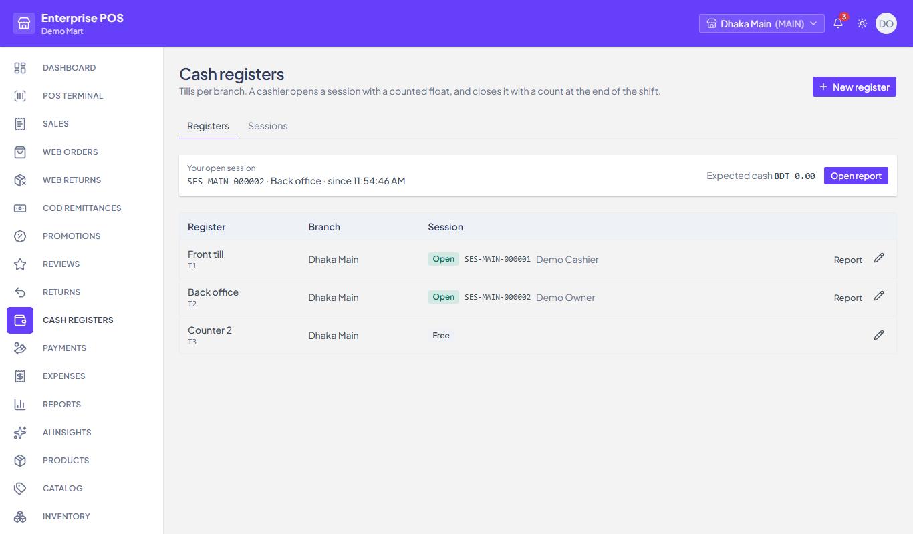

**"CASH REGISTERS"**-এ সব ক্যাশ সেশনের তালিকা আছে: কে খুলেছে, কখন, কত টাকা নিয়ে।

**দিন শেষে সেশন বন্ধ করার নিয়ম:**

1. POS-এ **"Close"** চাপুন।
2. ড্রয়ারের টাকা নিজে গুনে **গোনা টাকার পরিমাণ** লিখুন।
3. সফটওয়্যার দেখাবে কত থাকার কথা আর কত পাওয়া গেল। পার্থক্য (বেশি/কম) থাকলে কারণ লিখুন।
4. বন্ধ করুন। ম্যানেজার পরে এই তালিকা থেকে পার্থক্য দেখতে পারবেন।

---

## ৭. বিক্রির তালিকা ও পণ্য ফেরত

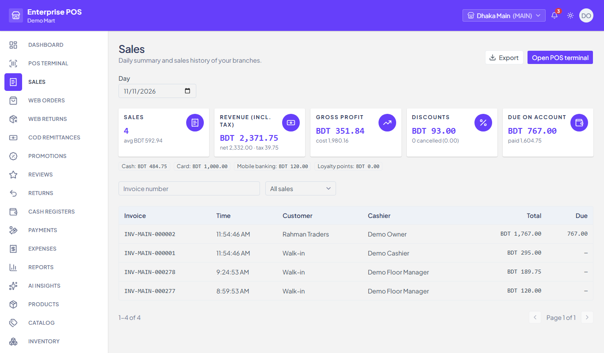

**"SALES"**-এ দোকানের সব বিক্রি আছে। তারিখ, ক্রেতা, টাকার পরিমাণ দিয়ে খুঁজুন। কোনো বিক্রিতে চাপলে বিস্তারিত দেখা যাবে আর রসিদ আবার প্রিন্ট করা যাবে।

**ক্রেতা পণ্য ফেরত দিলে:**

1. SALES থেকে বিক্রিটা খুলুন।
2. **"Return items"** চাপুন, তারপর কোন পণ্য কয়টা ফেরত আসছে আর কারণ লিখুন।
3. ক্যাশিয়ার শুধু **অনুরোধ** করতে পারে; ম্যানেজার **অনুমোদন** দিলে মাল স্টকে ফেরে আর টাকা ফেরত হয়।

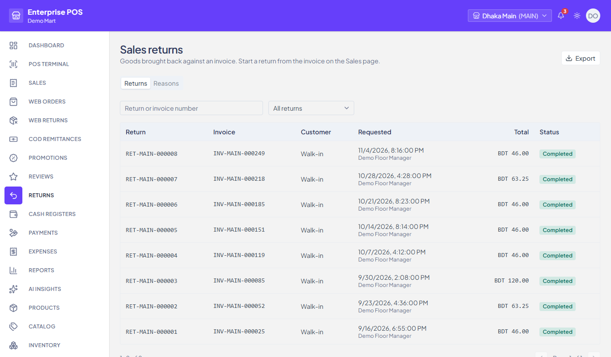

**"RETURNS"** পাতায় সব ফেরতের অনুরোধ ও তার অবস্থা দেখা যায়।

---

## ৮. পণ্য ও ক্যাটালগ

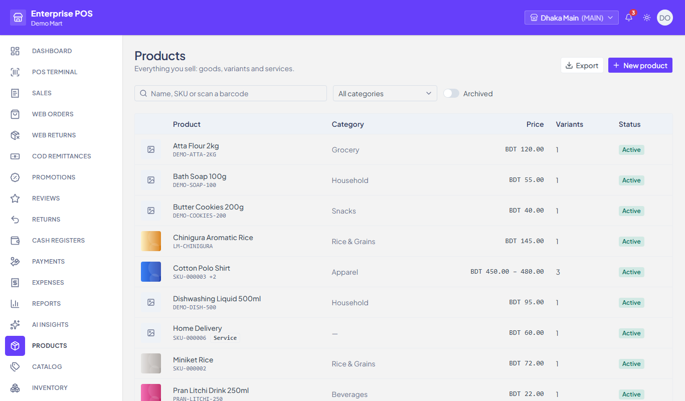

**"PRODUCTS"**-এ আপনি যা যা বিক্রি করেন তার তালিকা থাকে।

**নতুন পণ্য যোগ করতে:**

1. **"+ New product"** চাপুন।
2. নাম, ক্যাটাগরি, ব্র্যান্ড, একক (pcs, kg …) দিন।
3. **বিক্রয় মূল্য** আর **কেনা মূল্য** দিন। কেনা মূল্য থেকে লাভ হিসাব হয়।
4. বারকোড / SKU দিন। খালি রাখলে সফটওয়্যার নিজে SKU বানাবে।
5. সাইজ বা রঙ আলাদা হলে (যেমন শার্ট M, L, XL) **variant** যোগ করুন। প্রতিটার আলাদা দাম ও স্টক থাকে।
6. ভ্যাট/ট্যাক্স ঠিক করুন, তারপর Save করুন।

**কিছু টিপস:**

- "Home Delivery"-এর মতো **Service** পণ্যের স্টক লাগে না।
- পুরনো পণ্য মুছে না ফেলে **Archive** করুন, তাহলে পুরনো হিসাব ঠিক থাকবে। "Archived" সুইচ চালু করলে আর্কাইভ করা পণ্য দেখা যায়।

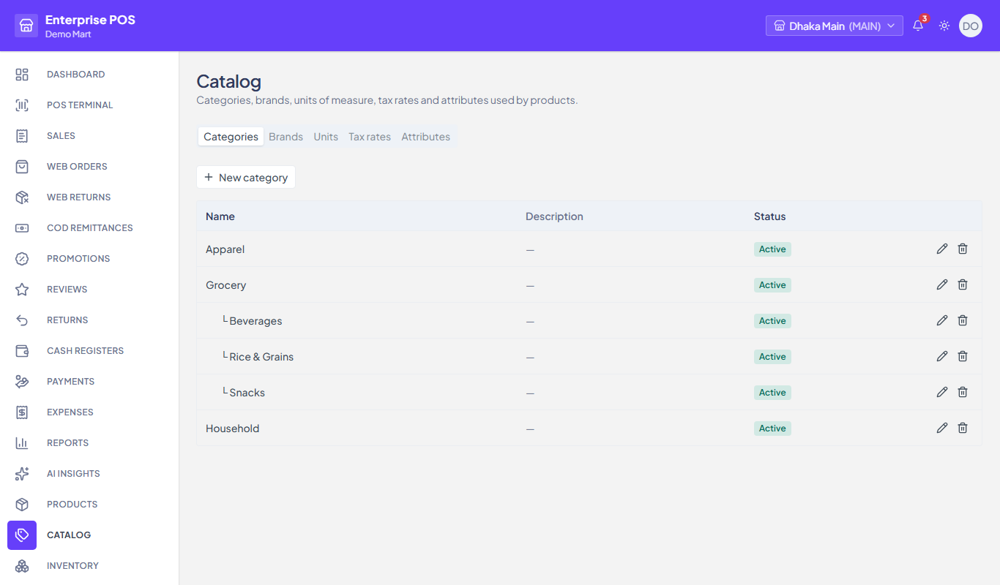

**"CATALOG"**-এ ক্যাটাগরি, ব্র্যান্ড, একক (unit) আর অ্যাট্রিবিউট (রঙ, সাইজ) সাজানো হয়। কোনো ক্যাটাগরিতে পণ্য থাকলে সেটা মোছা যাবে না; সফটওয়্যার জানিয়ে দেবে যে এটা ব্যবহার হচ্ছে।

---

## ৯. স্টক / ইনভেন্টরি

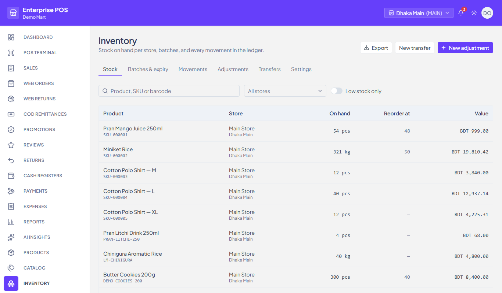

**"INVENTORY"**-তে প্রতিটা স্টোরে কোন পণ্য কত আছে (**On hand**) আর তার মূল্য (**Value**) দেখা যায়।

| ট্যাব | কাজ |
|---|---|
| **Stock** | বর্তমান স্টক। **"Low stock only"** চালু করলে শুধু কমে যাওয়া পণ্য দেখায়। |
| **Batches & expiry** | ব্যাচ ও মেয়াদ (ওষুধ, খাবারের জন্য)। কোনটার মেয়াদ শেষ হচ্ছে দেখুন। |
| **Movements** | প্রতিটা স্টক ঢোকা-বেরোনোর খাতা: কবে, কেন, কত। |
| **Adjustments** | গুনে মেলানো, নষ্ট/হারানো মাল বাদ দেওয়া। |
| **Transfers** | এক স্টোর থেকে অন্য স্টোরে মাল পাঠানো। |
| **Settings** | কত স্টক নামলে সতর্কতা দেবে (**Reorder at**) ইত্যাদি। |

- **স্টক মেলানো:** "**+ New adjustment**" → পণ্য বাছুন → আসল গোনা সংখ্যা ও কারণ লিখুন → Save। খাতায় (Movements) এর রেকর্ড থেকে যায়, মোছা যায় না।
- **অন্য শাখায় পাঠানো:** "**New transfer**" → কোথা থেকে কোথায় → পণ্য ও সংখ্যা। অন্য শাখা মাল পেলে "Receive" করবে।

---

## ১০. কেনাকাটা — সাপ্লায়ারের কাছ থেকে মাল আনা

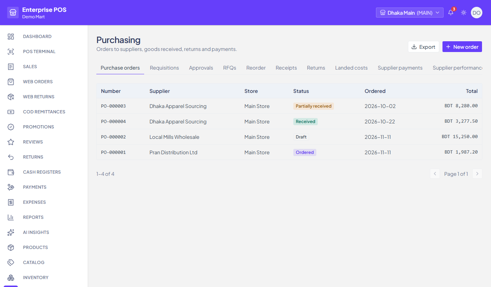

**"PURCHASING"**-এ অনেকগুলো ট্যাব আছে। সাধারণ নিয়মে কাজটা এভাবে চলে:

```
Reorder (কী আনতে হবে) → Purchase order (অর্ডার) → Receipts (মাল বুঝে নেওয়া) → Supplier payments (টাকা দেওয়া)
```

| ট্যাব | কাজ |
|---|---|
| **Purchase orders** | সাপ্লায়ারকে অর্ডার। অবস্থা: Draft → Ordered → Partially received → Received। |
| **Requisitions** | শাখা থেকে মাল চাওয়ার অনুরোধ। |
| **Approvals** | ম্যানেজারের অনুমোদনের অপেক্ষায় থাকা অনুরোধ/অর্ডার। |
| **RFQs** | কয়েকজন সাপ্লায়ারের কাছে দামের কোটেশন চাওয়া ও তুলনা করা। |
| **Reorder** | কোন মাল ফুরিয়ে আসছে আর কতটা আনতে হবে তার পরামর্শ। এক চাপে ড্রাফট অর্ডার তৈরি হয়। |
| **Receipts** | মাল আসলে বুঝে নেওয়া (GRN)। এতে স্টক বাড়ে। |
| **Returns** | সাপ্লায়ারকে মাল ফেরত। |
| **Landed costs** | গাড়িভাড়া, শুল্কের মতো বাড়তি খরচ মালের দামে যোগ করা। |
| **Supplier payments** | সাপ্লায়ারকে টাকা দেওয়া; বাকি কত তা দেখা। |
| **Supplier performance** | কোন সাপ্লায়ার সময়মতো পুরো মাল দেয় তার স্কোর। |

**নতুন অর্ডার:** "**+ New order**" → সাপ্লায়ার ও স্টোর বাছুন → পণ্য, সংখ্যা ও দাম দিন → Save (Draft) → পাঠানো হলে "Ordered" করুন।

**মাল এলে:** অর্ডারটা খুলে "Receive" করুন। যতটা এসেছে ততটা লিখুন। আংশিক এলে বাকিটা পরে আবার Receive করা যায়।

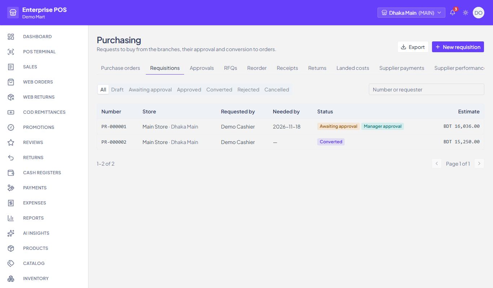

**শাখা থেকে অনুরোধ (Requisition):** শাখা ম্যানেজার কী লাগবে লিখে অনুরোধ পাঠান। অনুমোদনকারী **Approvals** থেকে অনুমোদন দেন, তারপর **"Convert"** চেপে এক বা একাধিক Purchase order বা RFQ বানিয়ে ফেলেন।

---

## ১১. গ্রাহক, সাপ্লায়ার ও লয়্যালটি পয়েন্ট

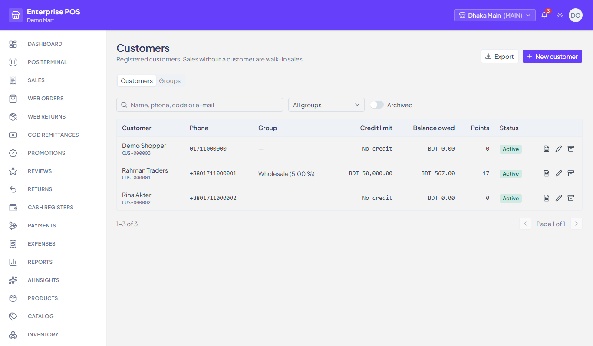

**"CUSTOMERS":** ক্রেতার নাম, মোবাইল, গ্রুপ (যেমন পাইকারি), বাকির সীমা (credit limit), কেনাকাটার ইতিহাস ও বাকি।

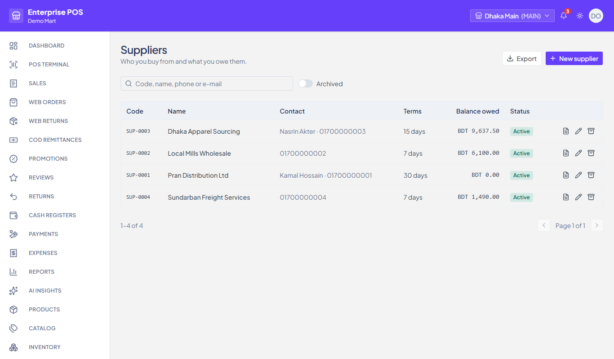

**"SUPPLIERS":** সাপ্লায়ারের তথ্য, তার কাছে আপনার কত বাকি (balance), পুরনো অর্ডার।

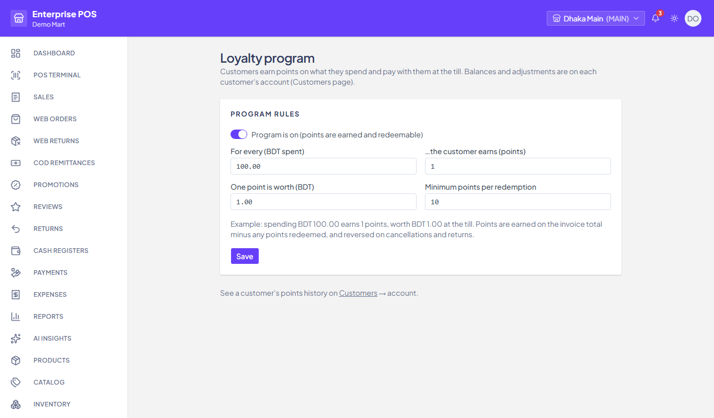

**"LOYALTY":** কেনাকাটায় ক্রেতা পয়েন্ট পান, পরের বার সেই পয়েন্টে ছাড় নিতে পারেন। কত টাকায় কত পয়েন্ট হবে তা এখানে ঠিক করুন।

---

## ১২. খরচ (Expenses)

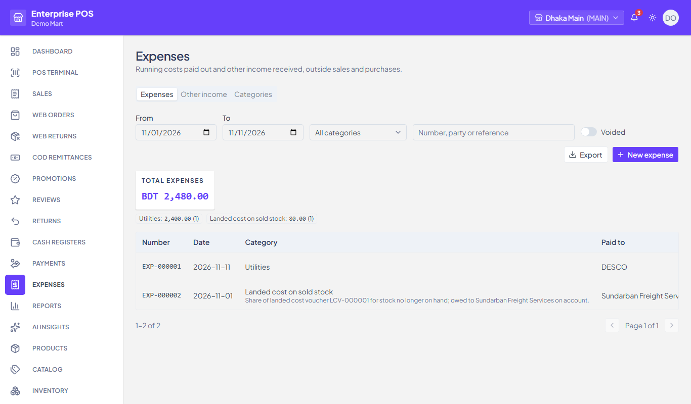

দোকান ভাড়া, বিদ্যুৎ বিল, বেতনের মতো খরচ এখানে লিখুন। খরচগুলো লাভ-ক্ষতির (Profit & Loss) রিপোর্টে যোগ হয়।

- নতুন খরচ: তারিখ, ক্যাটাগরি, পরিমাণ, কোন অ্যাকাউন্ট থেকে (ক্যাশ/ব্যাংক)।
- ভুল হলে মুছবেন না, **Void** করুন। তাহলে রেকর্ড থাকে কিন্তু হিসাব থেকে বাদ যায়।

---

## ১৩. অনলাইন অর্ডার, ডেলিভারি ও COD

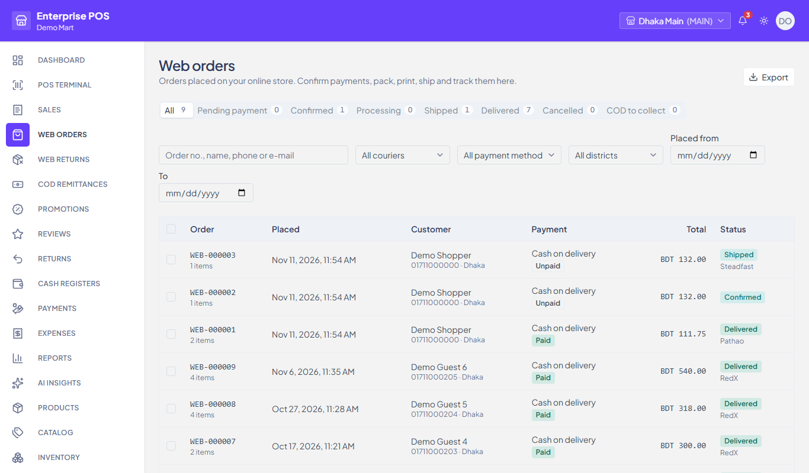

**"WEB ORDERS"**-এ অনলাইন দোকানের সব অর্ডার আছে। উপরের ট্যাবে অবস্থা অনুযায়ী সংখ্যা দেখায়: Pending payment, Confirmed, Processing, Shipped, Delivered, Cancelled, COD to collect।

**একটা অর্ডার সামলানোর ধাপ:**

1. **Confirm:** অর্ডার যাচাই করুন (দরকার হলে ক্রেতাকে ফোন করুন)।
2. **Processing:** মাল প্যাক করুন; প্যাকিং স্লিপ/ইনভয়েস প্রিন্ট করুন।
3. **Ship:** কুরিয়ার (Pathao, RedX, Steadfast …) আর ট্র্যাকিং নম্বর দিন।
4. **Delivered:** পৌঁছালে ডেলিভার্ড করুন।
5. **ব্যাংক ট্রান্সফার** হলে টাকা পেলে "payment received" করুন। নির্দিষ্ট সময়ে টাকা না এলে অর্ডার নিজে থেকে বাতিল হয়ে মাল স্টকে ফিরে যায়।

**COD (ক্যাশ অন ডেলিভারি) টাকা মেলানো:** কুরিয়ার যে টাকা তুলে আপনাকে পাঠায়, সেটা **"COD REMITTANCES"**-এ লিখুন: কোন কোন অর্ডারের টাকা, কুরিয়ারের চার্জ কত। এতে অর্ডারগুলো "Paid" হয়ে যায়।

**অনলাইন ফেরত:** **"WEB RETURNS"**-এ ক্রেতার ফেরতের অনুরোধ আসে। কাজের ধাপ: অনুমোদন → মাল ফেরত পেলে Receive (স্টকে যোগ হয়) → টাকা ফেরত (Refund)।

**রিভিউ:** **"REVIEWS"**-এ ক্রেতাদের রিভিউ জমা হয়। আপনি Approve করলে তবেই দোকানে দেখাবে।

---

## ১৪. অফার ও কুপন (Promotions)

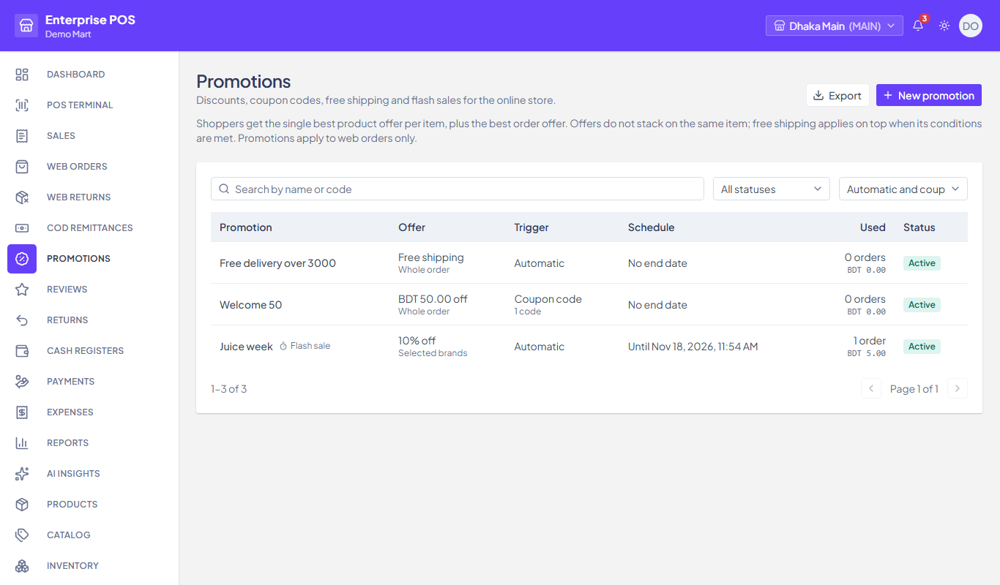

যেসব অফার বানানো যায়:

- নির্দিষ্ট পণ্য/ক্যাটাগরিতে % বা টাকা ছাড়;
- নির্দিষ্ট টাকার বেশি কিনলে ছাড় (যেমন ৪০০ টাকার বেশিতে ৫০ টাকা ছাড়);
- **কুপন কোড** (যেমন `WELCOME50`);
- **ফ্ল্যাশ সেল:** নির্দিষ্ট সময় পর্যন্ত বিশেষ দাম।

শুরু ও শেষের তারিখ দিন। অফার চালু থাকলে দাম নিজে থেকেই কমে যায়। প্রতিটা অফারের রিপোর্টে দেখা যায় কতবার ব্যবহার হলো আর মোট কত ছাড় গেল।

---

## ১৫. রিপোর্ট ও Excel/PDF ডাউনলোড

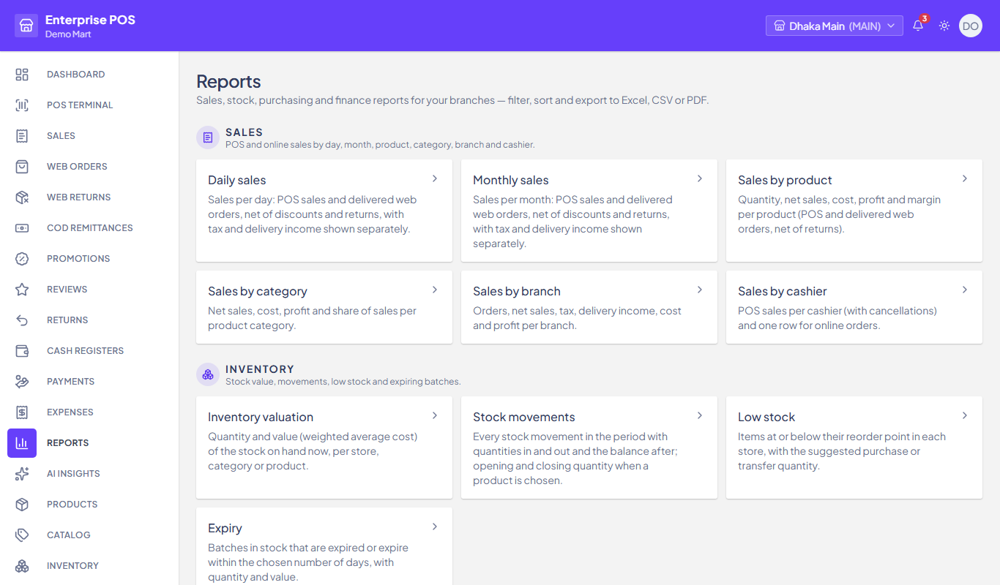

**"REPORTS"**-এ বিক্রি, স্টক, কেনাকাটা, গ্রাহক, ট্যাক্স, লাভ-ক্ষতির অনেক রিপোর্ট আছে। যেটা দরকার সেটায় চাপুন।

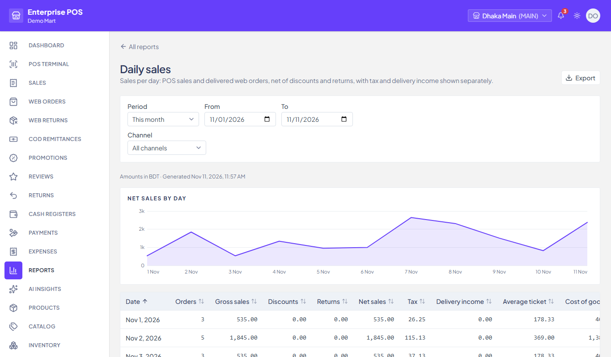

1. **Period** বা **From / To** দিয়ে সময় বাছুন।
2. আরও ফিল্টার দিন (শাখা, স্টোর, চ্যানেল …)।
3. গ্রাফ আর তালিকা দেখুন। কলামের নামে চাপলে তালিকা সাজানো যায়।
4. **"Export"** চেপে **Excel (xlsx)**, **PDF** বা **CSV** হিসেবে ডাউনলোড করুন। যে ফিল্টার দিয়েছেন সেটা মেনেই ফাইল হবে।

> মালের কেনা দাম ও লাভ শুধু অনুমতিপ্রাপ্ত ইউজাররাই দেখতে পান।

---

## ১৬. AI Insights — কৃত্রিম বুদ্ধিমত্তার সাহায্য

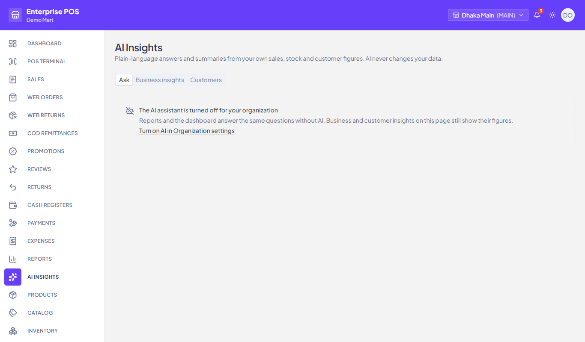

AI ঐচ্ছিক, শুরুতে **বন্ধ** থাকে। AI বন্ধ থাকলেও ব্যবসার হিসাবগুলো দেখা যায়:

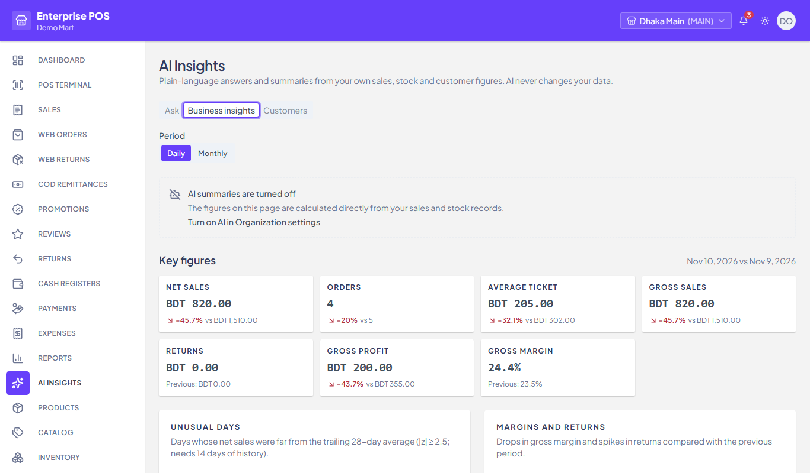

| ট্যাব | কী পাবেন |
|---|---|
| **Ask** | বাংলা বা ইংরেজিতে প্রশ্ন করুন, যেমন "গত সপ্তাহে কোন পণ্য সবচেয়ে বেশি বিক্রি হলো?"। উত্তর আসে আপনার নিজের রিপোর্ট থেকে। (AI চালু থাকলে) |
| **Business insights** | দৈনিক/মাসিক মূল হিসাব, আগের সময়ের সাথে তুলনা, অস্বাভাবিক দিন, যে মাল বিক্রি হচ্ছে না, যে মাল ফুরিয়ে যাওয়ার ঝুঁকি আছে। |
| **Customers** | ক্রেতাদের ভাগ (নিয়মিত, হারিয়ে যাচ্ছে, নতুন …) আর কাকে কী অফার দেওয়া যায় তার পরামর্শ। |

**চালু করবেন কীভাবে:** মালিক "**Turn on AI in Organization settings**" লিংক থেকে চালু করবেন। মাসিক ব্যবহারের সীমাও সেখানে ঠিক করা যায়।

> AI আপনার কোনো তথ্য বদলায় না, শুধু পড়ে ও ব্যাখ্যা করে। ক্রেতার নাম বা ফোন নম্বর AI-কে পাঠানো হয় না। কেনাকাটার **Reorder** পাতায় "Explain with AI" বোতাম চাপলে AI বুঝিয়ে দেয় কোন মাল আগে আনা উচিত।

---

## ১৭. অনলাইন দোকান সাজানো

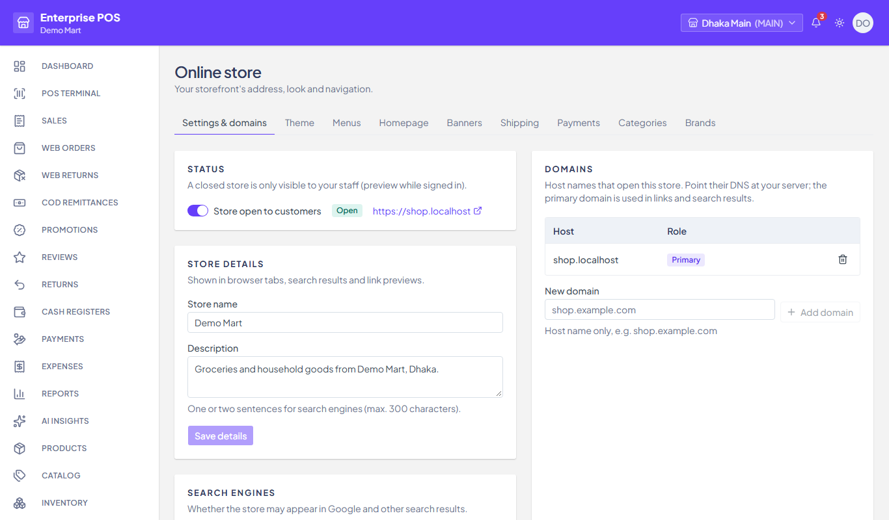

**"ONLINE STORE"**-এ যা যা করা যায়:

- দোকানের রঙ, লোগো, মেনু;
- হোমপেজের ব্যানার ও সেকশন (নতুন পণ্য, অফার, ব্লগ …);
- কোন পণ্য অনলাইনে দেখাবে, তার ছবি, বর্ণনা, বাংলা নাম;
- ডেলিভারি চার্জ (এলাকা অনুযায়ী), COD ফি, ব্যাংক অ্যাকাউন্টের তথ্য;
- অতিথি (লগইন ছাড়া) অর্ডার চালু/বন্ধ, কত দিনের মধ্যে ফেরত নেওয়া যাবে।

এছাড়া **"CONTENT"**-এ About us, FAQ-এর মতো পাতা আর ব্লগ লেখা যায়, আর **"MEDIA LIBRARY"**-তে ছবি রাখা হয়।

### ১৭.১ এক ক্লিকে দোকানের চেহারা বদলানো (থিম প্রিসেট)

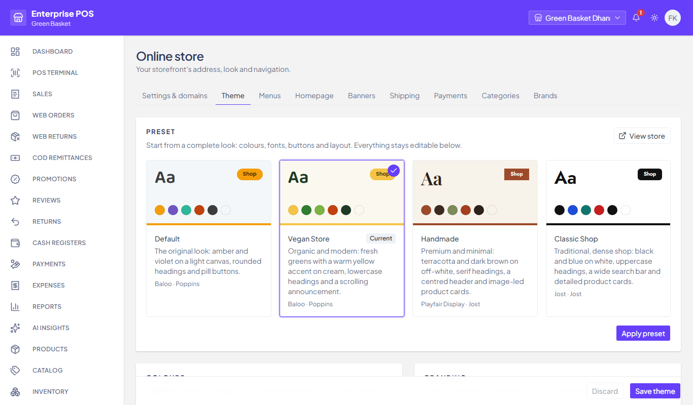

**ONLINE STORE → Theme** পাতার উপরে চারটি তৈরি চেহারা (প্রিসেট) আছে:

| প্রিসেট | কেমন দেখায় | কোন দোকানে মানায় |
|---|---|---|
| **Default** | আগের মতোই | যেকোনো দোকান |
| **Vegan Store** | সবুজ-হলুদ, গোল বাটন, ছোট হাতের হেডিং, উপরে চলমান অফার-লেখা | সবজি, খাবার, স্বাস্থ্য পণ্য |
| **Handmade** | মাটির রং, সেরিফ অক্ষর, চৌকো কোণ, ফাঁকা-ফাঁকা সাজানো | হস্তশিল্প, গয়না, ঘর সাজানো |
| **Classic Shop** | কালো-সাদা আর নীল, বড় হাতের হেডিং, বড় সার্চ বার, কার্টে মোট টাকা | কাপড়, জুতা, ব্যাগ — অনেক পণ্যের দোকান |

১. পছন্দের প্রিসেটে ক্লিক করুন → **Apply preset** চাপুন।
২. নিশ্চিত করার বার্তায় **Apply** চাপুন। রং, অক্ষর আর লেআউট বদলাবে; **লোগো, ঘোষণা-লেখা আর ফুটারের লেখা যেমন ছিল তেমনই থাকবে।**
৩. **View store** চেপে দোকান দেখে নিন। পছন্দ না হলে যেকোনো রং বা লেআউট আলাদা করে বদলে **Save theme** চাপুন।

### ১৭.২ তিনটি নমুনা (ডেমো) দোকান

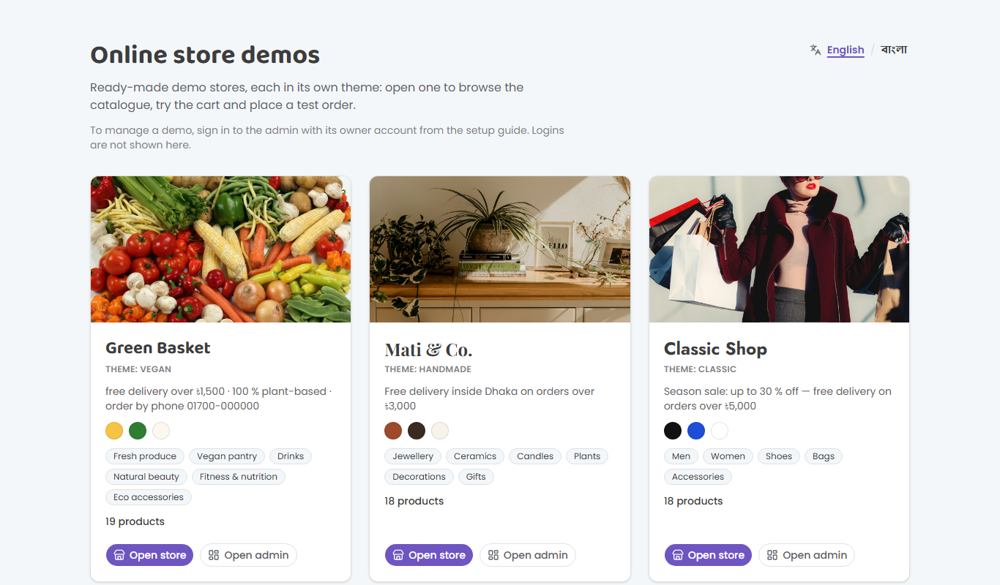

প্রশিক্ষণ বা ক্রেতাকে দেখানোর জন্য তিনটি সম্পূর্ণ নমুনা দোকান আছে — প্রতিটি **আলাদা প্রতিষ্ঠান**, তাই আপনার আসল দোকানের পণ্য, স্টক বা অর্ডারে কোনো প্রভাব পড়ে না:

| দোকান | চেহারা | ঠিকানা (টেস্ট সার্ভারে) | কুপন |
|---|---|---|---|
| **Green Basket** | Vegan Store | `vegan.shop.localhost` | `GREEN10` — ১,০০০ টাকার উপরে ১০ % ছাড় |
| **Mati & Co.** | Handmade | `handmade.shop.localhost` | `MATI15` — ৩,০০০ টাকার উপরে ১৫ % ছাড় |
| **Classic Shop** | Classic Shop | `classic.shop.localhost` | `CLASSIC20` — ৫,০০০ টাকার উপরে ২০ % ছাড় |

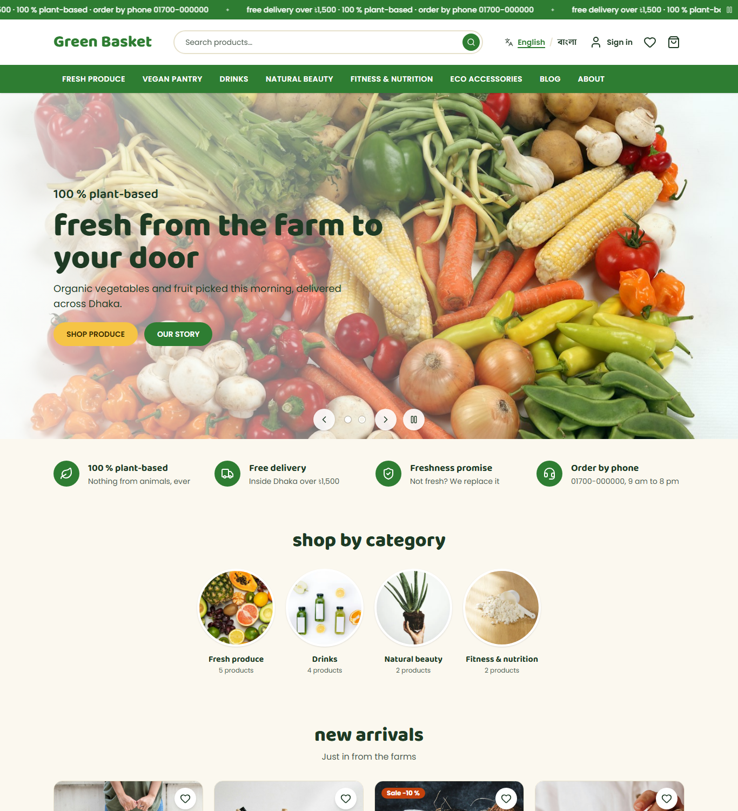

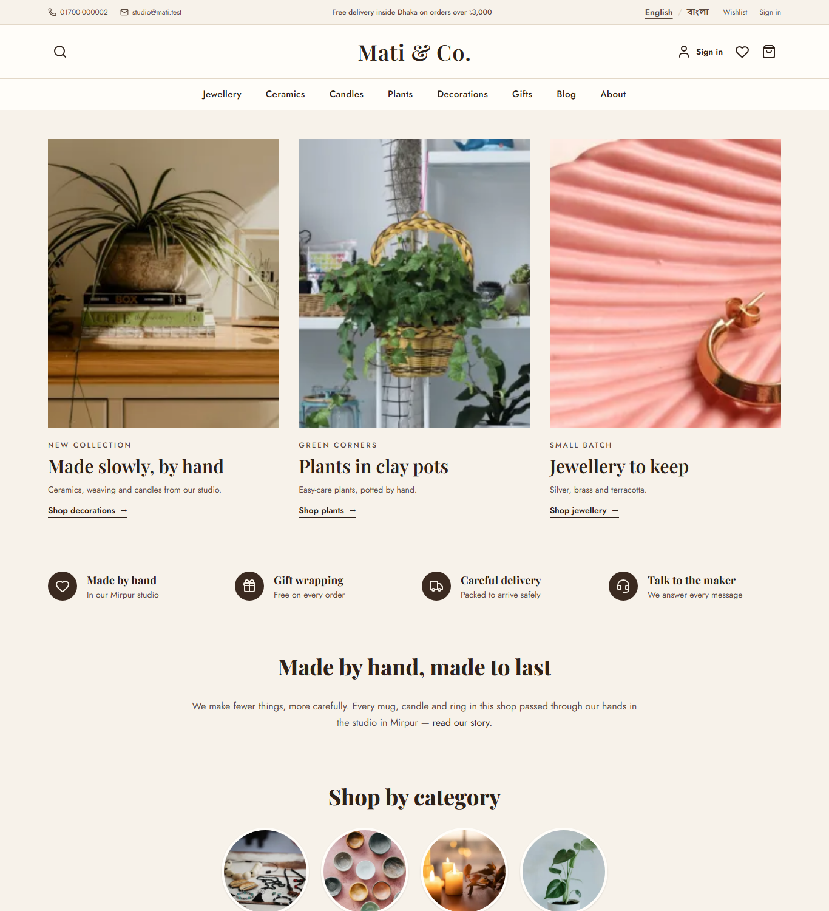


প্রতিটি দোকানে ছবিসহ ১৮–১৯টি পণ্য (সাইজ/রং/ফ্লেভার বেছে নেওয়া যায়), স্টক, ফ্ল্যাশ সেল (সময় গুনতে থাকা ঘড়িসহ), কুপন, মেনু, ব্যানার, ব্লগ, রিভিউ আর About / Contact / FAQ পাতা আছে। সত্যিকারের মতোই অর্ডার দেওয়া যায় — অর্ডার সেই দোকানের মালিকের **WEB ORDERS**-এ আসে আর স্টক কমে।

- সব ডেমো দোকানের তালিকা: `/demos` পাতা (শুধু টেস্ট সার্ভারে চালু থাকলে)।
- প্রতিটি দোকানের অ্যাডমিনে ঢুকতে নিচের "ডেমো অ্যাকাউন্ট" টেবিল দেখুন।
- ডেমো দোকান তৈরি করেন ডেভেলপার/আইটি (নিচের ছোট লেখা দেখুন); আসল সার্ভারে এগুলো থাকে না।

### ১৭.৩ পেজ বিল্ডার — টেনে এনে নিজের মতো হোমপেজ বানানো

কোডিং ছাড়াই দোকানের প্রথম পাতা (হোমপেজ) আর আলাদা অফার-পাতা (ল্যান্ডিং পেজ) সাজানো যায়। যা বদলাবেন তা **খসড়া** হিসেবে নিজে থেকেই সেভ হয় — **Publish** না চাপা পর্যন্ত ক্রেতারা পুরোনো পাতাই দেখেন।

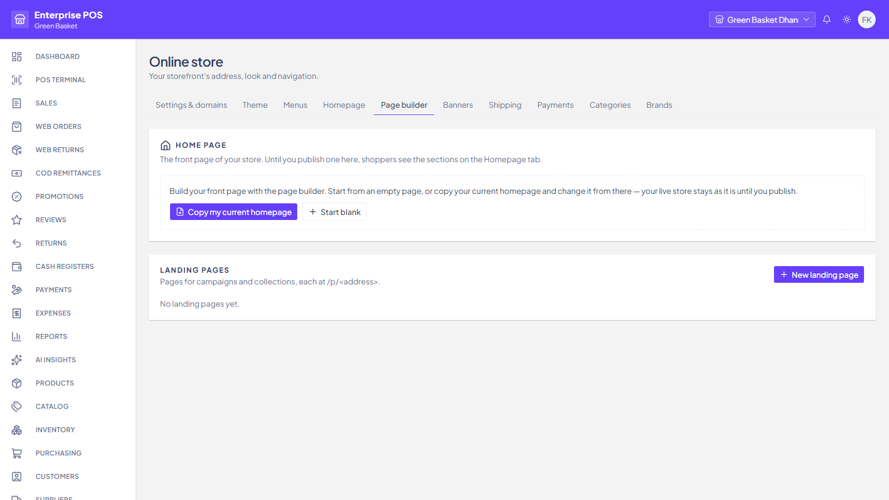

**শুরু করা:** **ONLINE STORE → Page builder**।
- **Copy my current homepage** — এখনকার হোমপেজের সব সেকশন কপি হয়ে আসে, সেখান থেকে বদলান (সবচেয়ে সহজ)।
- **Start blank** — খালি পাতা থেকে শুরু।
- **New landing page** — ঈদ অফার ইত্যাদির জন্য আলাদা পাতা; ঠিকানা হয় `/p/<নাম>` (যেমন `/p/eid-sale`)।

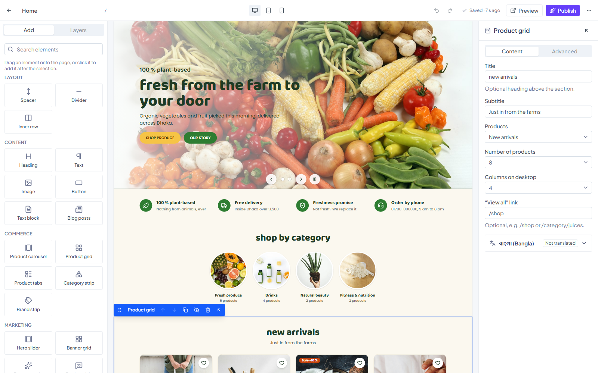

**এডিটরের তিন ভাগ:**
1. **বাঁ দিকে — Add:** Heading, Text, Image, Button, Product grid, Hero slider … যেকোনোটা **টেনে** মাঝের পাতায় যেখানে চান ছেড়ে দিন (নীল দাগ দেখাবে কোথায় বসবে), অথবা ক্লিক করলে বাছাই করা অংশের পরে যোগ হয়। Hero slider-এর মতো কিছু জিনিস আগে ব্যানার বেছে নিতে বলে।
2. **মাঝে — আপনার দোকান:** আসল দোকানের মতোই দেখায়। কোনো অংশে ক্লিক করলে নীল দাগ আর ছোট টুলবার আসে: উপরে/নিচে সরানো, কপি (Duplicate), লুকানো, মুছে ফেলা।
3. **ডান দিকে — Content / Advanced:** বাছাই করা অংশের লেখা, ছবি, লিংক, পণ্যের উৎস ইত্যাদি বদলান; লেখা টাইপ করার সাথে সাথে মাঝের পাতায় দেখা যায়। **বাংলা (Bangla)** ঘরে বাংলা লেখা দিন। **Advanced**-এ ঠিক করুন অংশটা ডেস্কটপ / ট্যাবলেট / মোবাইলে দেখাবে কি না, আর কোন তারিখ থেকে কোন তারিখ পর্যন্ত দেখাবে।

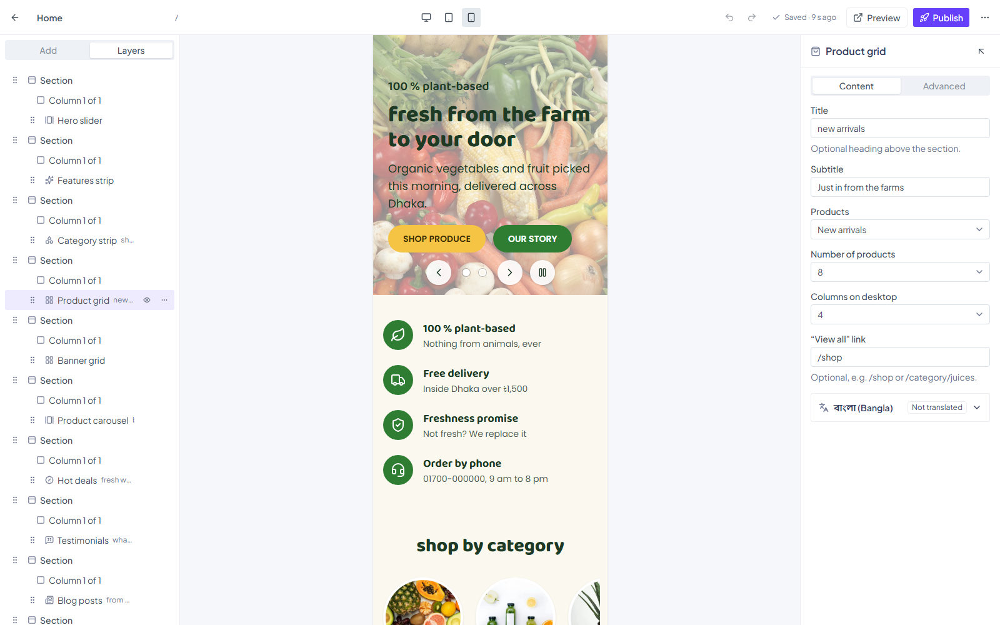

**উপরের টুলবার:**
- ডেস্কটপ / ট্যাবলেট / মোবাইল বোতাম — পাতাটা কোন স্ক্রিনে কেমন দেখাবে।
- Undo / Redo (Ctrl+Z / Ctrl+Shift+Z) — ভুল হলে আগের অবস্থায় ফেরা।
- **Saved · কত সেকেন্ড আগে** — খসড়া সেভ হয়েছে। লাল লেখা এলে ক্লিক করে ভুলটা ঠিক করুন।
- **Preview** — আসল দোকানে খসড়াটা দেখুন (শুধু আপনি দেখবেন)।
- **Publish** — সবাই দেখবে। একটা ছোট নোট লিখে রাখা যায় (যেমন "ঈদের ব্যানার")।
- **⋯ → Version history** — আগের যেকোনো প্রকাশিত সংস্করণ খসড়ায় ফিরিয়ে আনা যায়; **Discard changes** — শেষ প্রকাশিত অবস্থায় ফিরে যাওয়া।

**Layers** ট্যাবে পুরো পাতার তালিকা থাকে — টেনে ক্রম বদলান, চোখের চিহ্ন চেপে লুকান।

> **মনে রাখুন:** Publish করার অনুমতি সবার থাকে না (মালিক আর Online Store Manager-এর থাকে)।

### ১৭.৪ ডিজাইন — রং, ফন্ট, ফাঁকা জায়গা, মোবাইলের জন্য আলাদা সাজ

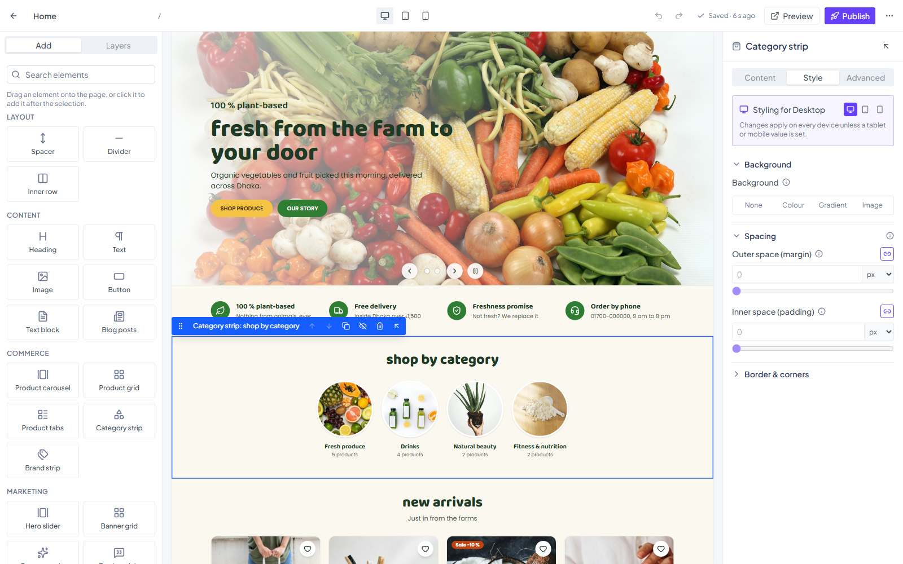

পেজ বিল্ডারে কোনো অংশ বাছাই করে ডান দিকের **Style** ট্যাবে যান:
- **Background** — একরঙা, গ্রেডিয়েন্ট (দুই বা তার বেশি রঙের মিশ্রণ) বা ছবি; ছবির উপর হালকা/গাঢ় আস্তরণ (overlay)।
- **Typography** — লেখার আকার, মোটা-পাতলা, লাইনের ফাঁক, অক্ষরের ফাঁক, বাঁ/মাঝে/ডানে।
- **Spacing** — ভেতরের ফাঁকা (padding) আর বাইরের ফাঁকা (margin); শিকল-চিহ্ন চাপলে চার দিক একসাথে বদলায়।
- **Border & corners**, **Shadow**, **Hover** (মাউস রাখলে রং বদলানো বা একটু উপরে ওঠা)।

রং বাছাইয়ে দোকানের থিমের রং, নিজের সেভ করা প্যালেট, তৈরি রং, HEX/RGB আর স্বচ্ছতা (opacity) — সব পাবেন।

**মোবাইল/ট্যাবলেটের জন্য আলাদা সাজ:** উপরের টুলবারে মোবাইল বোতাম চাপুন — Style ট্যাবের উপরে লেখা আসবে "Styling for Mobile"। এখন যা বদলাবেন তা শুধু মোবাইলে লাগবে; ডেস্কটপ যেমন ছিল তেমনই থাকবে। ভরাট বিন্দু মানে "এই ডিভাইসের জন্য আলাদা করা", ফাঁপা বিন্দু মানে "বড় স্ক্রিন থেকে নেওয়া"; পাশে **Reset** চাপলে আবার বড় স্ক্রিনের মান ফিরে আসে।

**কলামের চওড়া:** পাশাপাশি কলামের মাঝখানের দাগটা টেনে বড়-ছোট করুন (৫ % করে লাফায়, টানার সময় শতাংশ দেখায়)।

### ১৭.৫ পুরো দোকানের রং ও ফন্ট — খসড়া থেকে প্রকাশ

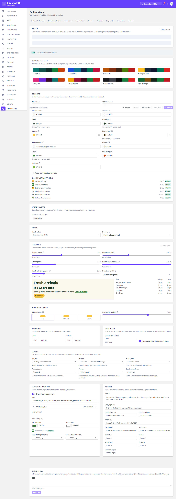

**ONLINE STORE → Theme** (অথবা পেজ বিল্ডারে কিছু বাছাই না করে **Site styles**):
- **Colour palettes** — এক ক্লিকে তৈরি রঙের সেট (সবগুলো পড়তে সহজ কিনা পরীক্ষা করা)।
- **Colours** — Primary, Secondary, Background, Text, Heading, Button, Button text, Button hover, Border, Link, Sale badge। পাশে লেখা থাকে লেখাটা পড়তে সহজ কিনা (AA pass)।
- **Store palette** — নিজের ৮টা পছন্দের রং সেভ করুন; সব রং-বাছাইয়ে দেখা যাবে।
- **Text sizes** — পুরো দোকানের লেখার আকার, হেডিং কত বড় হবে, মোবাইলে কতটা ছোট হবে; নিচে সাথে সাথে নমুনা দেখায়।

**গুরুত্বপূর্ণ:** এখন থিমও খসড়া হিসেবে থাকে। **Save draft** চাপলে শুধু খসড়া সেভ হয় — ক্রেতারা কিছু দেখেন না। **Preview** দিয়ে আসল দোকানে দেখে নিন, তারপর **Publish**। ভুল হলে **History** থেকে আগের থিম খসড়ায় ফিরিয়ে আনুন, বা **Discard** দিয়ে চালু থিমে ফিরে যান। তৈরি চেহারা (Preset) বেছে নিলেও তা আগে খসড়ায় যায়। (Custom CSS আগের মতোই সাথে সাথে চালু হয়।)

### ১৭.৬ About/FAQ পাতা, হেডার-ফুটার আর শপ পাতার অংশ

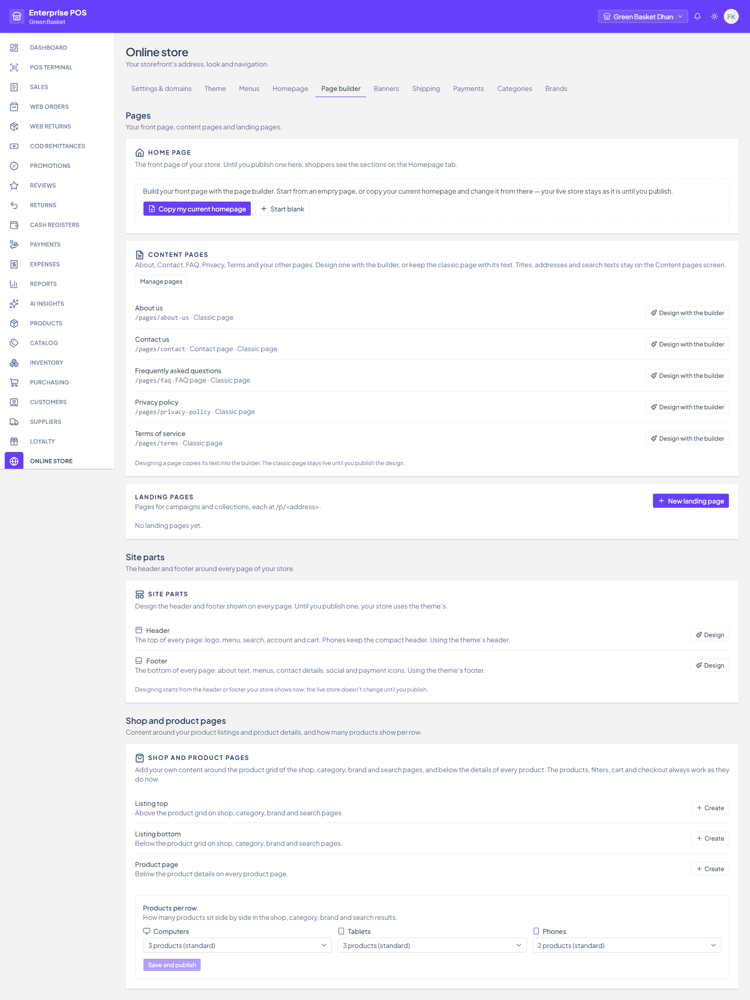

**ONLINE STORE → Page builder**-এ এখন তিন ভাগ:

**Pages**
- **Home** আর **Landing pages** — আগের মতোই।
- **Content pages** — About us, Contact, FAQ, Privacy, Terms ইত্যাদি। **Design with the builder** চাপলে পাতার লেখা বিল্ডারে কপি হয়ে আসে; FAQ পাতায় প্রশ্ন-উত্তরের তালিকা আর Contact পাতায় যোগাযোগ ফর্ম নিজে থেকেই থাকে এবং আগের মতোই কাজ করে। পাতার নাম, ঠিকানা আর সার্চ-লেখা আগের মতো **CONTENT → Pages**-এ বদলান। **Back to the classic page** চাপলে আগের সাধারণ পাতায় ফিরে যায়।

**Site parts — হেডার ও ফুটার**
- **Design** চাপলে এখনকার হেডার/ফুটার দিয়ে শুরু হয় — লোগো, মেনু, সার্চ, অ্যাকাউন্ট, পছন্দের তালিকা, কার্ট (সংখ্যা ও মোট টাকা), ঘোষণা, ভাষা বদল, সোশ্যাল আইকন, পেমেন্টের লোগো, যোগাযোগ, কপিরাইট, নিউজলেটার — টেনে সাজান।
- মোবাইলে দোকান নিজের ছোট হেডার আর মেনু-ড্রয়ার ব্যবহার করে (ট্যাবলেট ও কম্পিউটারে আপনার ডিজাইন)। ফুটার সব স্ক্রিনে আপনার ডিজাইন।
- লোগো, সোশ্যাল লিংক, যোগাযোগের তথ্য আর পেমেন্টের লোগো আসে **Theme** পাতা থেকে; মেনুর লিংক **Menus** থেকে।
- **Use the theme's header/footer** চাপলে আগের হেডার/ফুটারে ফিরে যায়।

**Shop and product pages**
- **Listing top / Listing bottom** — শপ, ক্যাটাগরি, ব্র্যান্ড আর সার্চের পাতায় পণ্যের তালিকার উপরে/নিচে নিজের অংশ (যেমন অফারের ব্যানার বা Call to action)।
- **Product page** — প্রতিটি পণ্যের বিবরণের নিচে একই অংশ (যেমন "ফ্রি ডেলিভারি" আইকন বা ভিডিও)।
- **Products per row** — কম্পিউটার, ট্যাবলেট আর মোবাইলে এক সারিতে কয়টা পণ্য দেখাবে (স্বাভাবিক: ৩ / ৩ / ২)।
- পণ্যের তালিকা, ফিল্টার, কার্ট আর চেকআউট সবসময় আগের মতোই কাজ করে।

**নতুন অংশ (Add প্যানেলে):** Video (YouTube/Vimeo লিংক — ক্রেতা চাপলে তবেই লোড হয়), Icon, Countdown (তারিখ বা ফ্ল্যাশ সেল পর্যন্ত ঘড়ি), Discount (কুপন কোড কপি করার বোতামসহ), Call to action, Search box, Promoted product, আর **Custom HTML**।

> **Custom HTML:** শুধু মালিক (Organization Admin) যোগ বা বদলাতে পারেন; স্ক্রিপ্ট ইত্যাদি নিজে থেকেই মুছে ফেলা হয়। অন্যরা এটা সরাতে/লুকাতে/মুছতে পারেন, কিন্তু লেখা বদলাতে পারেন না।

### ১৭.৭ তৈরি ডিজাইন (Templates) আর ডেমো দোকানের চেহারা দিয়ে শুরু

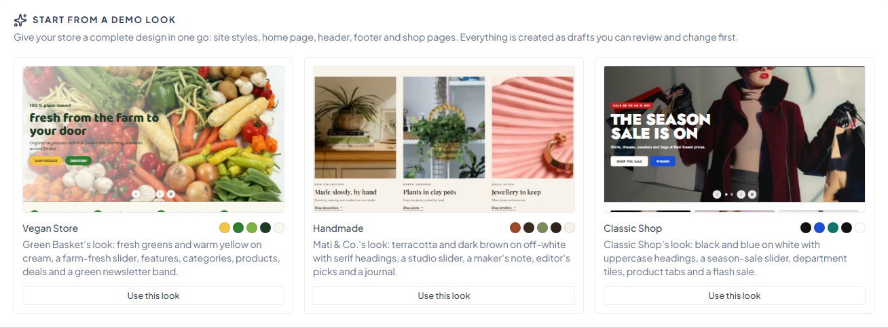

**এক ক্লিকে পুরো দোকান সাজানো — "Start from a demo look":** **ONLINE STORE → Page builder**-এর উপরে তিনটি তৈরি চেহারা — **Vegan Store**, **Handmade**, **Classic Shop**।
1. পছন্দের চেহারায় **Use this look** চাপুন।
2. কোন কোন অংশ নেবেন বেছে নিন (রং-ফন্ট, হোমপেজ, হেডার, ফুটার, শপ পাতার উপরের অংশ) → **Create drafts**।
3. সব কিছু **খসড়া** হিসেবে তৈরি হয় — ক্রেতারা এখনো আগের দোকানই দেখেন। প্রতিটির **Preview** দেখে নিন, চাইলে **Edit** চেপে বদলান।
4. সব ঠিক থাকলে **Publish all** — এক ক্লিকে সব চালু।

ছবিগুলো আপনার দোকানের Media library-তে কপি হয়ে যায়; পণ্য দেখায় আপনার নিজের দোকানের পণ্য থেকেই।

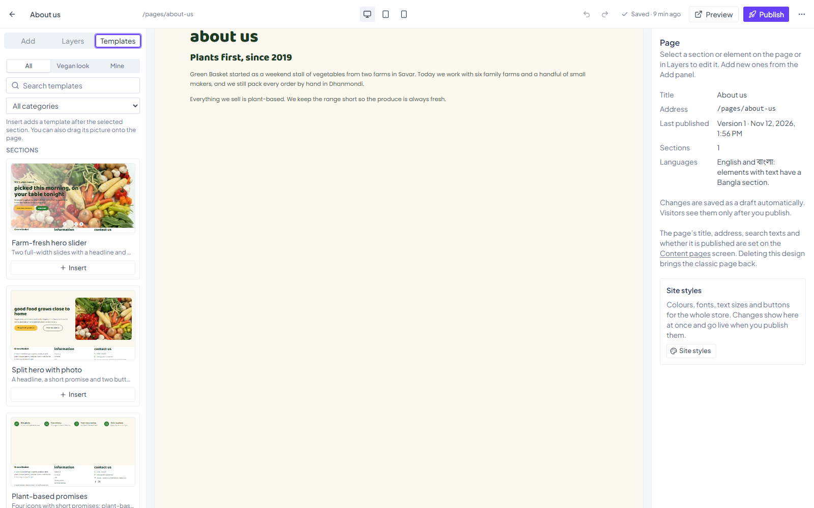

**তৈরি সেকশন — Templates ট্যাব:** পেজ বিল্ডারে বাঁ দিকে **Templates** ট্যাবে ৪৬টি তৈরি ডিজাইন — হিরো ব্যানার, বৈশিষ্ট্য, ক্যাটাগরি, পণ্যের সারি, অফারের ঘড়ি, ক্রেতাদের মন্তব্য, নিউজলেটার, ভিডিও আর লেখা, About/Contact/FAQ/অফার পাতা ইত্যাদি।
- **All / Vegan look / Mine** দিয়ে বাছাই করুন, নাম দিয়ে খুঁজুন।
- **Insert** চাপুন অথবা ছবিটা টেনে পাতায় ছেড়ে দিন। ভুল হলে Undo।

**নিজের ডিজাইন সেভ করা:** কোনো সেকশনের ছোট টুলবারে (বা Layers-এর ⋯ মেনুতে) **Save as template** — নাম দিন; পরে **Mine** ট্যাবে পাবেন এবং অন্য পাতাতেও বসাতে পারবেন।

---

## ১৮. ইউজার, রোল ও প্রতিষ্ঠানের সেটিংস

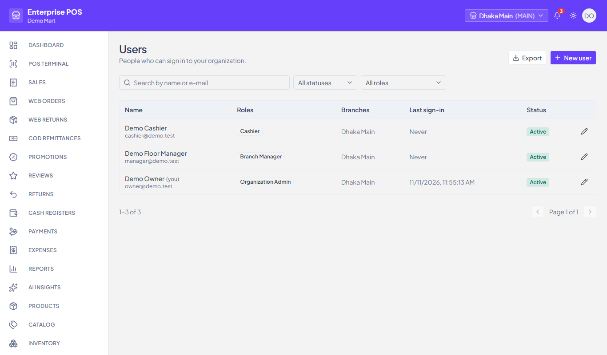

**"USERS":** নতুন স্টাফ যোগ করুন। দিতে হবে নাম, ই-মেইল, রোল আর কোন শাখায় কাজ করবে। কেউ চাকরি ছাড়লে তাকে **Inactive** করুন।

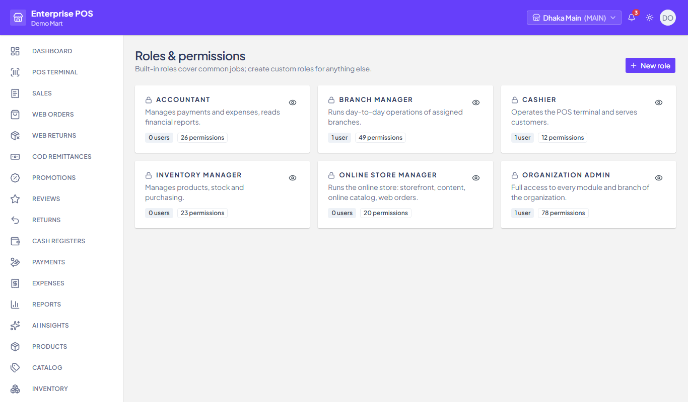

**"ROLES & PERMISSIONS":** কোন রোল কী করতে পারবে তা ঠিক করুন। তৈরি রোলগুলো সাধারণত যথেষ্ট; দরকার হলে নিজের রোল বানান।

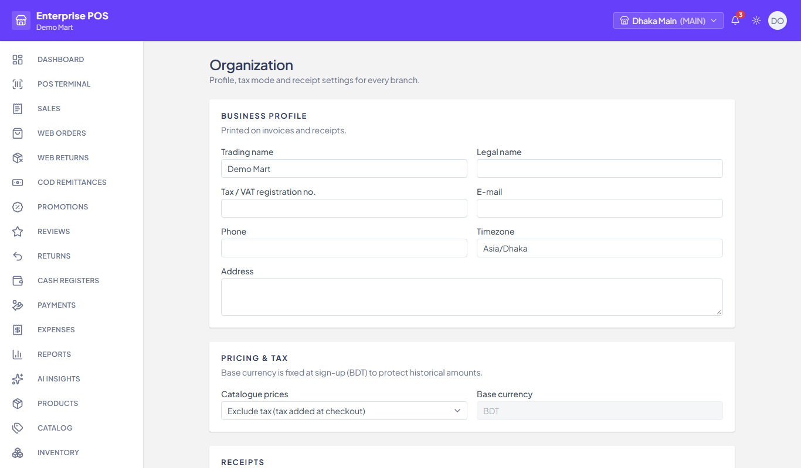

**"ORGANIZATION":** দোকানের নাম, ঠিকানা, BIN/ট্যাক্স নম্বর, টাইমজোন, রসিদের উপরে-নিচের লেখা, ইনভয়েস নম্বরের শুরু (prefix), AI সেটিংস।

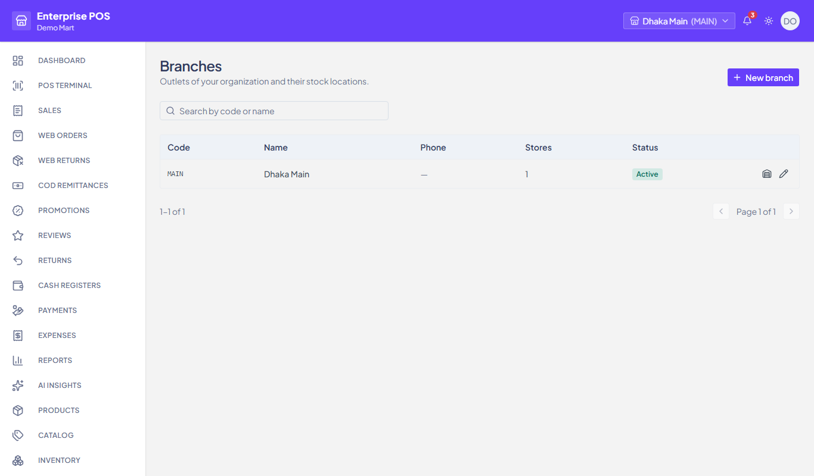

**"BRANCHES":** শাখা ও প্রতিটা শাখার স্টোর (গুদাম/শোরুম) যোগ করুন।

**"AUDIT LOG":** কে কখন কী বদলেছে তার রেকর্ড। কোনো সন্দেহ হলে এখানে দেখুন।

---

## ১৯. ক্রেতার চোখে অনলাইন দোকান

এই অংশটা স্টাফদের জানার জন্য, যাতে ক্রেতাকে ফোনে সাহায্য করতে পারেন।

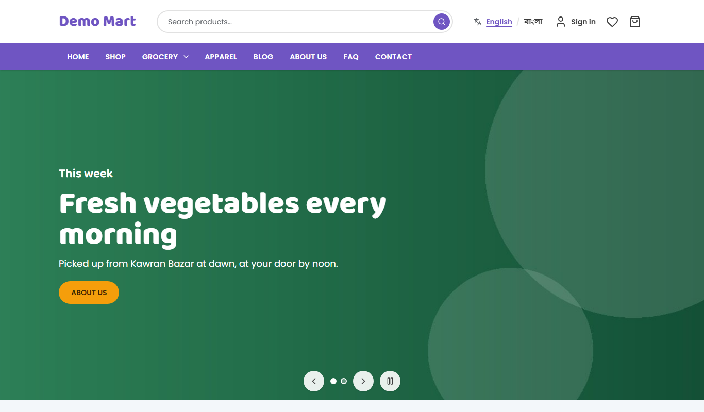

উপরে ডানে **English / বাংলা** চেপে ভাষা বদলানো যায়:

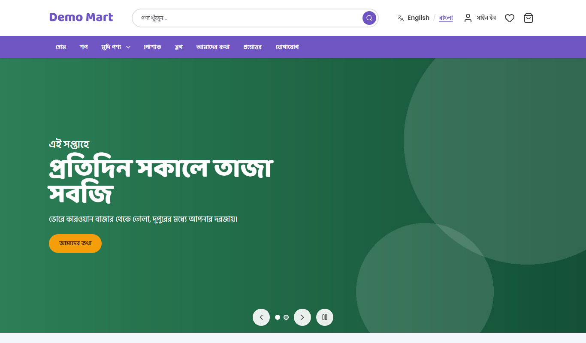

**ক্রেতা যেভাবে কেনেন:**

1. **Shop** বা ক্যাটাগরি থেকে পণ্য খোঁজেন, অথবা উপরের সার্চে লেখেন।

   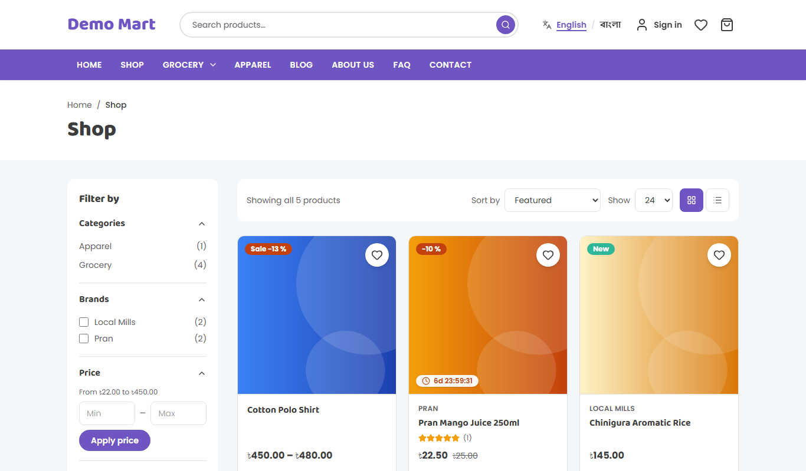

2. পণ্যের পাতায় পরিমাণ বেছে **"Add to cart"** চাপেন।

   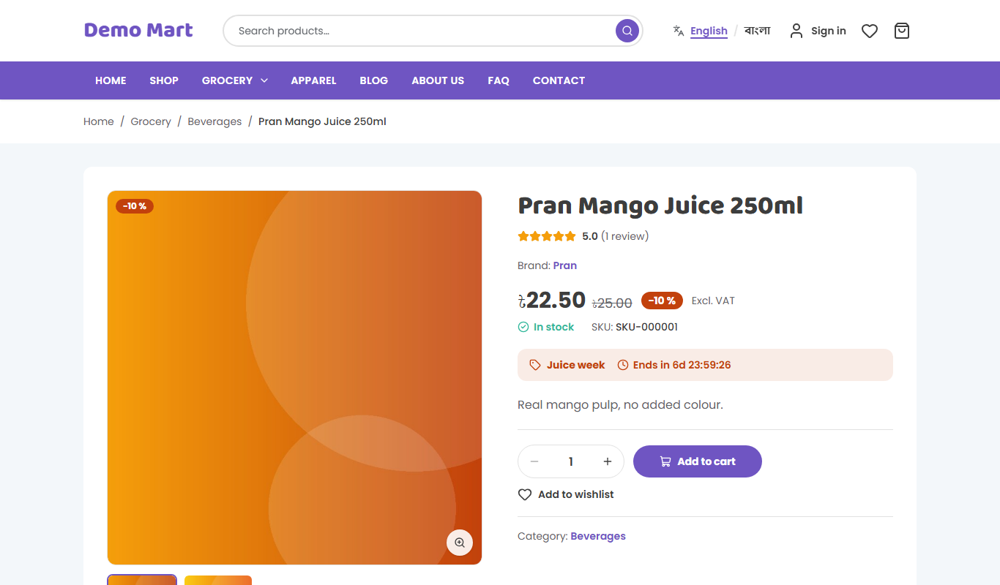

3. পাশে ছোট কার্ট খোলে; সেখান থেকে **Cart** বা **Checkout**-এ যান।

   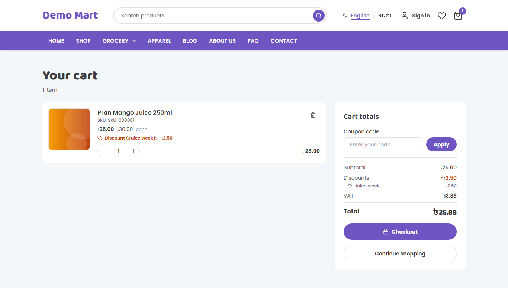

4. **Checkout:** নাম, মোবাইল, ঠিকানা (বিভাগ → জেলা → এলাকা), ডেলিভারির ধরন, পেমেন্ট (**Cash on delivery** বা **Bank transfer**) দিয়ে **"Place order"** চাপেন। ডান পাশে মোট দাম, ছাড়, ভ্যাট আর ডেলিভারি চার্জ দেখায়।

   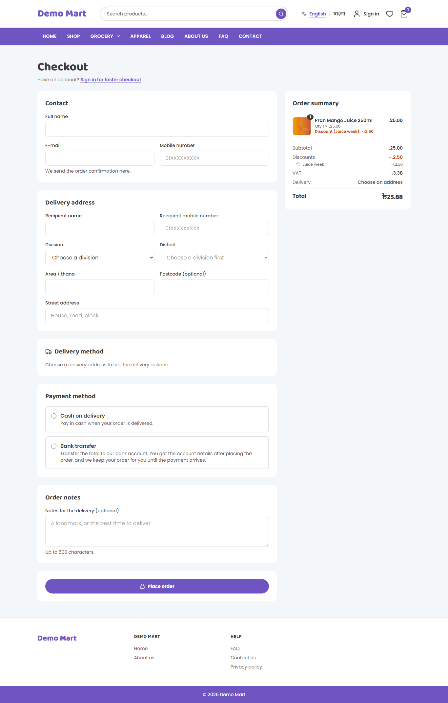

5. ক্রেতা অ্যাকাউন্ট খুললে (**Sign in / Register**) পরের বার দ্রুত অর্ডার করতে পারেন। "My orders"-এ অর্ডারের অবস্থা দেখা, বাতিল করা, আবার কেনা, ফেরতের অনুরোধ আর রিভিউ দেওয়া যায়।

   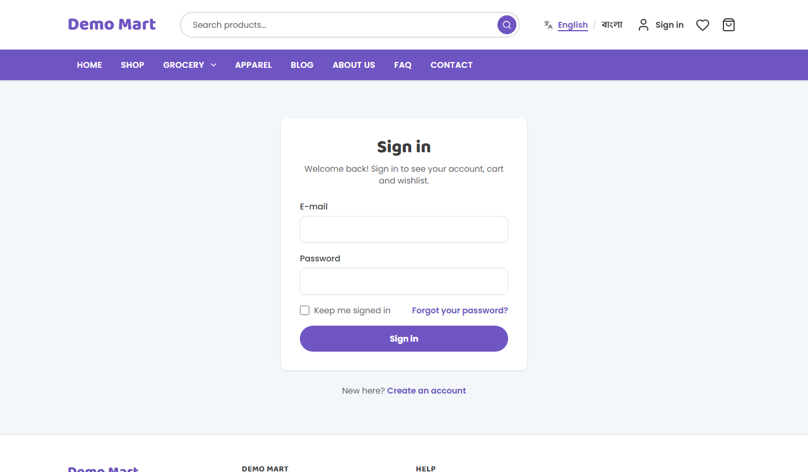

---

## ২০. দৈনিক কাজের তালিকা

**সকালে (ক্যাশিয়ার):**
- [ ] লগইন → POS TERMINAL → ক্যাশ সেশন খুলুন (শুরুর টাকা গুনে লিখুন)।

**সারাদিন:**
- [ ] প্রতিটা বিক্রি POS-এ করুন, রসিদ দিন।
- [ ] অনলাইন অর্ডার (WEB ORDERS) Confirm → Ship করুন।
- [ ] ঘণ্টার চিহ্নে নোটিফিকেশন দেখুন।

**সন্ধ্যায়:**
- [ ] ড্রয়ারের টাকা গুনে সেশন **Close** করুন।
- [ ] ম্যানেজার: ড্যাশবোর্ডে দিনের বিক্রি ও লাভ দেখুন।
- [ ] INVENTORY → "Low stock only" দেখুন → দরকার হলে PURCHASING → Reorder থেকে অর্ডার করুন।

**সপ্তাহে / মাসে:**
- [ ] কুরিয়ারের COD টাকা মেলান (COD REMITTANCES)।
- [ ] সাপ্লায়ারের বাকি পরিশোধ করুন।
- [ ] খরচ (EXPENSES) লিখে রাখুন।
- [ ] REPORTS থেকে মাসের লাভ-ক্ষতি আর ট্যাক্স রিপোর্ট Excel/PDF-এ নামিয়ে রাখুন।
- [ ] গুদামের মাল গুনে Adjustment দিয়ে স্টক মেলান।

---

## ২১. সাধারণ সমস্যা ও সমাধান

| সমস্যা | কী করবেন |
|---|---|
| কোনো মেনু দেখা যাচ্ছে না | আপনার রোলে অনুমতি নেই। মালিক/ম্যানেজারকে বলুন। |
| POS-এ বিক্রি করা যাচ্ছে না | ক্যাশ সেশন খোলা আছে কিনা আর ঠিক স্টোর বাছা আছে কিনা দেখুন। |
| "স্টক নেই" বলছে | INVENTORY-তে ওই স্টোরের স্টক দেখুন; মাল এসে থাকলে Receive বা Adjustment করুন। |
| কোনো জিনিস মোছা যাচ্ছে না, বলছে "in use" | জিনিসটা অন্য জায়গায় ব্যবহার হচ্ছে (যেমন ক্যাটাগরিতে পণ্য আছে)। মোছার বদলে Archive/Inactive করুন। |
| অনেকবার ভুল পাসওয়ার্ড দেওয়ার পর লগইন হচ্ছে না | কিছুক্ষণ অপেক্ষা করুন, অথবা "Forgot password" দিয়ে রিসেট করুন। |
| ড্রয়ারে টাকা কম/বেশি | সেশন বন্ধের সময় কারণ লিখুন। Cash in/out ঠিকমতো লেখা হয়েছিল কিনা দেখুন। |
| অনলাইন দোকান খুলছে না, "There is no open store" | দোকানের ঠিকানা (ডোমেইন) সেটিংস বা অনলাইন দোকান চালু আছে কিনা অ্যাডমিন দেখবেন। |
| AI উত্তর দিচ্ছে না | AI বন্ধ আছে, বা মাসের সীমা শেষ। ORGANIZATION সেটিংস দেখুন। |

---

### ডেমো অ্যাকাউন্ট (শুধু টেস্ট/প্রশিক্ষণের সার্ভারে)

| কে | ই-মেইল | পাসওয়ার্ড |
|---|---|---|
| মালিক | `owner@demo.test` | `password` |
| ম্যানেজার | `manager@demo.test` | `password` |
| ক্যাশিয়ার | `cashier@demo.test` | `password` |
| ক্রেতা (অনলাইন) | `shopper@demo.test` | `password` |
| Green Basket-এর মালিক | `owner@greenbasket.test` | `password` |
| Mati & Co.-এর মালিক | `owner@mati.test` | `password` |
| Classic Shop-এর মালিক | `owner@classicshop.test` | `password` |

> **সতর্কতা:** এই অ্যাকাউন্টগুলো শুধু ডেমো ডেটার জন্য। আসল দোকানের সার্ভারে এগুলো থাকবে না, নিজের শক্ত পাসওয়ার্ড ব্যবহার করুন।

<sub>ছবিগুলো আবার তুলতে (ডেভেলপারদের জন্য): seeded backend চালিয়ে `MANUAL_SHOTS=1 npx playwright test e2e/manual-shots.spec.ts --project=desktop-chromium`। ছবি জমা হয় `docs/manual/images/`-এ। ডেমো দোকানের ছবি (৩৮–৪২): backend-এ `php artisan db:seed --class=DemoThemesSeeder` চালিয়ে, `MANUAL_SHOTS=1 E2E_DEMOS=1` দিয়ে একই কমান্ড। ডেমো দোকান তৈরি: `php artisan db:seed --class=DemoThemesSeeder` (`.env`-এ `TRUSTED_PROXIES=127.0.0.1`, `STOREFRONT_DEMO_GALLERY=true`; বিস্তারিত README-তে)।</sub>
